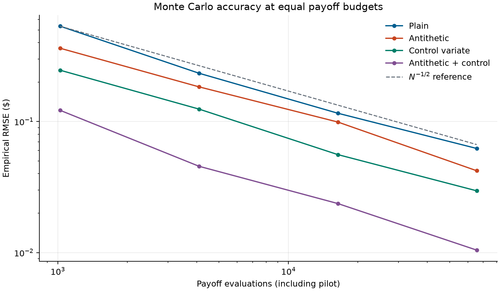

# Black–Scholes Options Pricing Lab

This lab asks how closely a binomial tree and a random simulation can price the same European option as the Black–Scholes–Merton formula. A European call lets its holder buy at a fixed price on the expiration date. A put lets its holder sell at that price.

To try the simplest case, run the menu and choose **1**. Enter a stock price of 100, a strike of 100, one year, a rate of 5, and volatility of 20. The call price is **$10.45**. The menu takes percentages and assumes zero dividends. Use the Python functions below to include dividends, recover volatility from a price, or compare methods.

## Run the lab

```sh
python -m venv .venv
source .venv/bin/activate
python -m pip install -r requirements-dev.txt
python main.py
python -m pytest -q
python -m experiments --output results
```

CI runs the suite on Python 3.12 and 3.14. The interactive plots require a graphical Matplotlib backend. The experiment runner renders PNGs headlessly.

## Python API

Rates, dividend yields, and volatility are annual decimals. Time is in years. The option type is `"call"` or `"put"`.

```python
from analysis import calculate_greeks, numerical_greeks
from implied_volatility import implied_volatility
from lattice import crr_price
from monte_carlo import monte_carlo_price
from pricing import black_scholes_merton

stock, strike, years, rate, vol = 100.0, 105.0, 1.0, 0.04, 0.24
args = (stock, strike, years, rate, vol)
yield_rate = 0.02
price = black_scholes_merton(*args, dividend_yield=yield_rate)
implied_vol = implied_volatility(price, stock, strike, years, rate, dividend_yield=yield_rate)
tree = crr_price(*args, dividend_yield=yield_rate, steps=1024)
mc = monte_carlo_price(
    *args, dividend_yield=yield_rate, paths=32_768, seed=42, antithetic=True, control_variate=True
)
exact_greeks = calculate_greeks(*args, dividend_yield=yield_rate)
bumped_greeks = numerical_greeks(*args, dividend_yield=yield_rate, relative_step=1e-4)
print(round(price, 4), round(implied_vol, 4))  # 8.1357, 0.24
print(tree, mc.price, mc.confidence_interval)
```

The original `black_scholes_call`, `black_scholes_put`, and `calculate_d1` interfaces require positive maturity and volatility. The new pricers also accept zero maturity and zero volatility. Both Greek methods require positive maturity and volatility.

## Model and numerical methods

All methods assume a frictionless model with a constant continuously compounded risk-free rate $r$, a constant proportional dividend yield $q$, and a constant volatility $\sigma$. Under the risk-neutral measure the stock follows geometric Brownian motion with drift $r-q$ and diffusion $\sigma$. Contracts settle at maturity with a vanilla payoff. The model omits early exercise, discrete dividends, jumps, transaction costs, and volatility smiles.

### Closed-form pricing and implied volatility

Let $A=Se^{-qT}$, $B=Ke^{-rT}$, $w=\sigma\sqrt{T}$, and $m=\log(S/K)+(r-q)T$. With $\Phi$ denoting the standard normal CDF,

$$
d_1=m/w+w/2,\qquad d_2=m/w-w/2
$$

$$
C=A\Phi(d_1)-B\Phi(d_2),\qquad
P=B\Phi(-d_2)-A\Phi(-d_1),\qquad C-P=A-B.
$$

A subtraction can lose significant digits when its two terms are nearly equal. The implementation uses `erfc` for normal tails, `log1p` near equal spot and strike, and `expm1` for the discounted difference near forward parity. It computes the out-of-the-money leg directly and recovers the in-the-money leg through parity. At forward parity it evaluates the price with `erf`, which retains precision at tiny total volatility. Expiry returns intrinsic payoff and zero volatility returns the discounted deterministic payoff.

Implied volatility is the volatility that reproduces the supplied price under BSM. For positive maturity the call bounds are $\max(A-B,0)$ and $A$, and the put bounds are $\max(B-A,0)$ and $B$. The solver doubles a bracket in total volatility and bisects the time value. The lower bound returns zero. When the rate and dividend yield are equal, both cash flows share a discount factor, so the code discounts the spot–strike payoff directly. For example, with spot 105, strike 100, one year, and zero rate and yield, a call price of exactly $5 implies zero volatility. Expiry, the upper bound, and prices outside the bounds raise `ValueError`. When time value rounds away or vega is very small, implied volatility can be poorly identified.

### Cox–Ross–Rubinstein tree

For $n$ steps, $\Delta t=T/n$, $u=e^{\sigma\sqrt{\Delta t}}$, $d=1/u$, and $p=(e^{(r-q)\Delta t}-d)/(u-d)$. The implementation discounts terminal payoffs once and rolls them back with the risk-neutral weights. It takes $O(n^2)$ time and $O(n)$ space. The strict condition $d<e^{(r-q)\Delta t}<u$ applies to the stochastic tree. Increase the step count when coarse steps violate this condition. Error can oscillate as the strike moves relative to the terminal nodes.

### Monte Carlo

With $Z$ standard normal, the discounted stock at maturity is $X=A\exp(-w^2/2+wZ)$, and the discounted payoff is $Y=\max(s(X-B),0)$, where $s=1$ for a call and $s=-1$ for a put. Simulation samples this terminal distribution directly, so there is no time-discretization error.

Antithetic sampling averages each pair from $Z$ and $-Z$ and treats the pair as one observation when estimating standard error. The control variate uses $Y-\beta(X-A)$, with $\beta$ fitted on a separate pilot sample. With both methods enabled, the fit and the adjustment use pair averages. `paths` counts production payoff evaluations and `pilot_paths` counts additional evaluations when used. The normal-approximation 95% interval is the estimate ± 1.96 standard errors. Rare-payoff contracts and small samples can give misleading intervals, including zero estimated error when every sampled payoff is zero.

### Greeks

Delta and gamma are the first and second spot derivatives. Theta is $-\partial V/\partial T$ divided by 365. Vega and rho are derivatives with respect to annualized volatility and rate, each divided by 100 to express a one-percentage-point move. Analytical derivatives hold the dividend yield constant. Numerical comparisons use centered price bumps, including a second-order centered stencil for gamma. Large bumps introduce truncation error and very small ones amplify rounding error. Bump preferences vary with contract and Greek.

Arithmetic uses double precision. Extreme inputs can still cause underflow, overflow, or loss of significance. The methods accept negative rates and yields when the resulting arithmetic remains representable.

## Reproducible experiments

The checked-in [results](results/) include CSV tables, figures, and the [environment and seed](results/environment.txt). The study uses synthetic model parameters. Black–Scholes–Merton provides a common reference for discretization and sampling error.

| Study | Design | Observed result |
| --- | --- | --- |
| [Tree convergence](results/tree.csv) | Four strikes, with even and adjacent odd step counts from 16 to 2,049 | At strike 105, absolute error went from $0.1310 at 16 steps to $0.001013 at 2,048. At 2,049 steps it was $0.000356. |
| [Monte Carlo accuracy](results/monte_carlo.csv) | Four estimators, 48 independent replications per budget, with pilot evaluations included | At 65,536 evaluations the RMSEs were $0.06230 for plain sampling, $0.04213 for antithetic, $0.02961 for control, and $0.01045 for both. The combined 95% interval covered the reference in 47 of 48 replications. |
| [Greek accuracy](results/greeks.csv) | Two option types, five Greeks, thirteen relative bumps | Call gamma error falls as the bump shrinks, then rises when price rounding dominates. |

The tree study uses spot 100, maturity one year, rate 4%, yield 2%, and volatility 24%. The sampling and Greeks studies use the same parameters and strike 105. The figures show selected series from the full tables. The Monte Carlo comparisons measure error at equal payoff evaluation budgets. Timing and generalization to other contracts are outside the experiment design. Small floating-point and rendering differences can occur across platforms.



[CRR convergence figure](results/tree.png) · [Greek finite-difference error figure](results/greeks.png)

## Verification

The 48 tests from `research-foundation` passed before the changes. The expanded suite passed 84 tests locally on Python 3.14.6 and verifies closed-form reference values, tail behavior, dividend parity, implied-volatility inversion and bounds, deterministic limits, single-step CRR pricing and convergence, seeded sampling and variance reduction, all five analytical Greeks against centered differences, and generation of the research artifacts.

## References

- Black and Scholes (1973), *The Pricing of Options and Corporate Liabilities*. [Journal of Political Economy](https://doi.org/10.1086/260062)
- Merton (1973), *Theory of Rational Option Pricing*. [The Bell Journal of Economics and Management Science](https://doi.org/10.2307/3003143)
- Cox, Ross, and Rubinstein (1979), *Option Pricing: A Simplified Approach*. [Journal of Financial Economics](https://doi.org/10.1016/0304-405X(79)90015-1)
