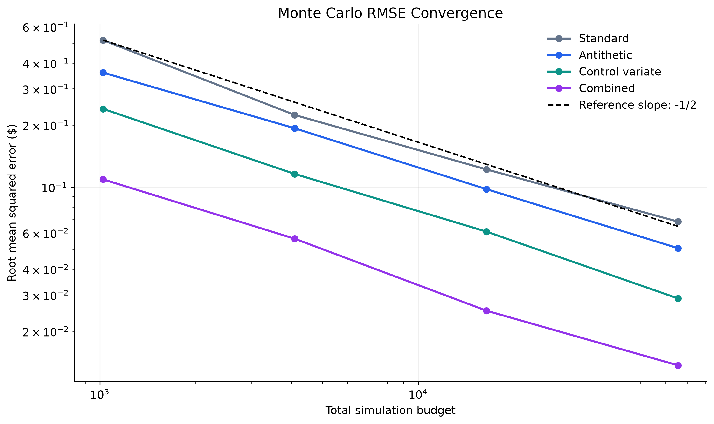
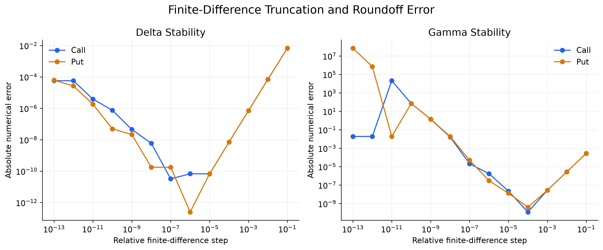
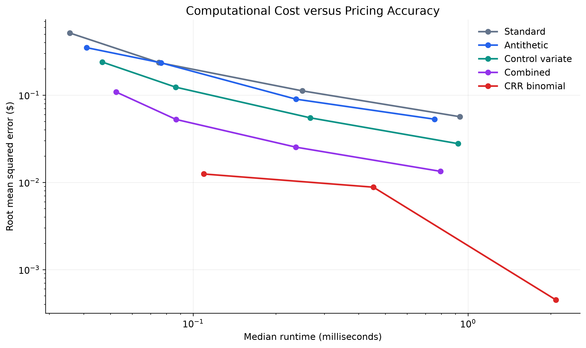

# Derivatives Pricing Laboratory

[](https://docs.python.org/3.14/)
[](https://github.com/LakshSuri/black-scholes-options-lab/actions/workflows/tests.yml)

A Python laboratory for European and American option valuation, numerical approximation, variance reduction, sensitivity analysis, and reproducible computational experiments.

The project compares established derivatives pricing methods under controlled mathematical assumptions, with an emphasis on numerical accuracy, statistical uncertainty, and computational cost.

**[Technical report](research/technical_report.md) · [Research datasets](results/data/) · [Research figures](results/figures/) · [Continuous integration](https://github.com/LakshSuri/black-scholes-options-lab/actions/workflows/tests.yml)**

## Overview

| Pricing implementations | Computational studies | Experimental observations | Recorded local tests |
|:---:|:---:|:---:|:---:|
| 6 | 5 | 2,958 | 212 passing |

The six pricing implementations comprise one analytical model, one binomial model, and four Monte Carlo estimators. The laboratory also includes analytical and numerical calculations of five Greeks, an implied volatility solver, thirteen interactive menu features, eight interactive visualization types, eight published CSV datasets, and six research figures.

## Contents

- [Quick start](#quick-start)
- [Mathematical framework](#mathematical-framework)
- [Research findings](#research-findings)
- [Python examples](#python-examples)
- [Project architecture](#project-architecture)
- [Reproducibility and validation](#reproducibility-and-validation)
- [Limitations](#limitations)
- [References](#references)
- [Future development](#future-development)
- [Development transparency](#development-transparency)

## Quick start

Use Python 3.14. The recorded development environment is CPython 3.14.6 on macOS (ARM64). The installation commands below are for macOS or Linux with Python 3.14 already installed.

```bash
git clone https://github.com/LakshSuri/black-scholes-options-lab.git
cd black-scholes-options-lab
python3.14 -m venv .venv
source .venv/bin/activate
python -m pip install -r requirements.txt
python -m pip check
python main.py
```

For Windows PowerShell, create and activate the environment using `py -3.14 -m venv .venv` and `.venv\Scripts\Activate.ps1` instead. Windows compatibility has not been independently validated.

### Interactive application

| Analytical pricing | Sensitivity analysis | Computational finance |
|---|---|---|
| 1. European call pricing | 5. Volatility sensitivity | 9. Implied volatility solver |
| 2. European put pricing | 6. Expiration sensitivity | 10. European and American binomial pricing |
| 3. Call and put comparison | 7. Interactive visualizations | 11. Monte Carlo pricing |
| 4. Analytical Greeks | 8. Put-call parity | 12. Pricing model comparison |
| | | 13. Numerical Greeks validation |

Select option 14 to exit. The visualization menu contains option pricing, volatility, expiration, and all five Greek plots. The CLI accepts rates and volatility as percentages; the Python functions accept decimal values.

## Mathematical framework

| Module | Method and capabilities |
|---|---|
| [Analytical pricing](pricing.py) | Dividend-adjusted Black-Scholes-Merton valuation for European calls and puts |
| [Binomial pricing](lattice.py) | Cox-Ross-Rubinstein recombining tree, backward induction, European and American exercise |
| [Monte Carlo](monte_carlo.py) | Risk-neutral terminal asset simulation, variance reduction, standard errors and approximate confidence intervals |
| [Implied volatility](implied_volatility.py) | Price-bound validation, expanding bracket and bisection |
| [Analytical Greeks](analysis.py) | Delta, Gamma, Theta, Vega and Rho |
| [Numerical Greeks](numerical_greeks.py) | Central finite-difference sensitivities and numerical comparisons |

The dividend-adjusted European call price is

$$
C = Se^{-qT}N(d_1) - Ke^{-rT}N(d_2),
$$

where

$$
d_1=\frac{\ln(S/K)+(r-q+\sigma^2/2)T}{\sigma\sqrt{T}},\qquad d_2=d_1-\sigma\sqrt{T}.
$$

Here, $S$ is the asset price, $K$ the strike, $T$ the time to expiration, $r$ the continuously compounded risk-free rate, $q$ the continuous dividend yield, $\sigma$ annualized volatility, and $N$ the standard normal cumulative distribution function.

The Monte Carlo engine includes standard, antithetic, control-variate and combined estimators. Independent antithetic pair averages are used for uncertainty estimation; control coefficients are estimated using separate pilot samples included in the total simulation budget. Theta is reported per calendar day, and Vega and Rho per one percentage-point change in volatility or interest rate.

Detailed formulas, derivations, experimental designs, and assumptions are provided in the [technical report](research/technical_report.md).

## Research findings

The five studies use synthetic option parameters and compare numerical estimates against the Black-Scholes-Merton reference where applicable. These results evaluate computational behavior under a common model rather than predictive accuracy against historical market prices.

| Study | Recorded observations | Dataset |
|---|---:|---|
| Binomial convergence | 128 | [Convergence data](results/data/tree_convergence.csv) |
| Monte Carlo convergence | 1,600 | [Summary](results/data/monte_carlo_summary.csv) · [Replications](results/data/monte_carlo_replications.csv) |
| Numerical Greek stability | 390 | [Stability data](results/data/greek_stability.csv) · [Best tested steps](results/data/optimal_greek_steps.csv) |
| Implied volatility conditioning | 240 | [Conditioning data](results/data/volatility_conditioning.csv) |
| Computational benchmarking | 600 | [Summary](results/data/benchmark_summary.csv) · [Replications](results/data/benchmark_replications.csv) |
| **Total** | **2,958** | |

The count excludes summary rows and does not imply that all observations are statistically independent.

### 1. Binomial convergence

Four strike prices (80, 95, 100, and 120 USD), two European option types, and sixteen tree resolutions (16–2,049 steps) were evaluated with asset price of 100 USD, expiration one year, risk-free rate 5%, volatility 20%, and dividend yield 2%.

For the call with a strike of 80 USD, signed pricing error changes from −0.002995 at 16 steps to −0.009224 at 32 steps. This demonstrates that increasing tree resolution does not necessarily reduce absolute error monotonically. Consecutive even and odd resolutions expose oscillatory behavior.


*Figure 1. European call pricing error across even and odd CRR tree resolutions.*

### 2. Monte Carlo convergence and variance reduction

Four estimators were evaluated at four simulation budgets, with 100 replications per configuration. The European call uses $S=100$, $K=105$, $T=1$, $r=5\%$, $\sigma=25\%$, and $q=2\%$. Its analytical reference price is 8.941176 USD.

| Total simulation budget | Standard RMSE | Antithetic RMSE | Control RMSE | Combined RMSE |
|---:|---:|---:|---:|---:|
| 1,024 | 0.516336 | 0.359410 | 0.239647 | 0.109060 |
| 4,096 | 0.223915 | 0.192989 | 0.115875 | 0.056191 |
| 16,384 | 0.121932 | 0.097804 | 0.060858 | 0.025163 |
| 65,536 | 0.068021 | 0.050569 | 0.028845 | 0.013657 |

The combined estimator achieved the lowest observed RMSE at every tested budget. At 65,536 evaluations, it reduced RMSE by approximately **79.9%**, corresponding to an empirical MSE ratio of **24.81** relative to standard Monte Carlo. This is a statistical comparison at equal evaluation budgets, not a 24.81-fold runtime speedup.



*Figure 2. Observed RMSE by estimator with a reference slope of −1/2.*

#### Confidence interval coverage

At the largest simulation budget, empirical coverage of approximate 95% confidence intervals was:

| Standard | Antithetic | Control | Combined |
|---:|---:|---:|---:|
| 94% | 98% | 97% | 97% |

The coverage estimates are broadly consistent with nominal coverage, but 100 replications limit statistical precision. These results do not establish coverage guarantees for other option parameters.


*Figure 3. Empirical coverage compared with the nominal 95% confidence level.*

### 3. Numerical Greek stability

Thirteen relative step sizes from $10^{-1}$ to $10^{-13}$ were evaluated across three market scenarios, two option types and five Greeks.

| Greek | Best relative step sizes observed |
|---|---|
| Delta | 1e-7 to 1e-6 |
| Gamma | 1e-4 |
| Theta | 1e-5 |
| Vega | 1e-6 to 1e-5 |
| Rho | 1e-5 to 1e-3 |

Gamma achieved its minimum observed error at 1e-4 in all six scenario and option-type combinations. The results illustrate the competing effects of finite-difference truncation and floating-point cancellation. These are minima within the tested grid, not universal optimal step sizes.



*Figure 4. Finite-difference stability for at-the-money calls and puts.*

### 4. Implied volatility conditioning

Five strikes, four expiration periods, two option types and six price perturbations were evaluated.

| Outcome | Count |
|---|---:|
| Successful numerical recovery | 208 |
| Outside strict pricing bounds | 32 |
| Solver failures | 0 |

For a locally invertible European pricing function, $\partial\sigma/\partial V=1/(\partial V/\partial\sigma)$. Low Vega can therefore amplify small option-price perturbations into large volatility errors. The heatmap shows theoretical inverse sensitivity, not realized errors from individual perturbations.


*Figure 5. Local implied volatility conditioning, displayed on a logarithmic color scale.*

### 5. Computational benchmarking

Twenty computational configurations were evaluated with thirty timed executions per configuration. Selected results from the recorded local environment are shown below.

| Model | Resolution | Median runtime (ms) | RMSE |
|---|---:|---:|---:|
| Black-Scholes-Merton | Analytical | 0.001167 | 0 |
| CRR binomial | 1,024 steps | 2.086354 | 0.000449 |
| Standard Monte Carlo | 65,536 | 0.933958 | 0.056573 |
| Antithetic Monte Carlo | 65,536 | 0.755375 | 0.052959 |
| Control variate | 65,536 | 0.920001 | 0.027772 |
| Combined Monte Carlo | 65,536 | 0.794209 | 0.013368 |

The analytical reference has zero measured approximation error by construction. The 1,024-step CRR tree achieved the smallest non-reference error in this benchmark; the combined Monte Carlo method achieved the lowest stochastic RMSE. Runtime depends on the machine, software and system load. Tree steps and simulation counts are different units of computational resolution.



*Figure 6. Measured computational cost versus accuracy. The zero-error analytical reference is omitted from the logarithmic plot.*

## Python examples

From the repository root, the individual mathematical engines can be imported directly. Rates, yields and volatility are expressed as decimals.

```python
from pricing import black_scholes_call
from lattice import crr_price
from monte_carlo import monte_carlo_price
from implied_volatility import implied_volatility
from analysis import calculate_greeks
from numerical_greeks import numerical_greeks

market = (100, 105, 1, 0.05, 0.25)
q = 0.02

# Analytical European call price
reference = black_scholes_call(*market, dividend_yield=q)
print(f"European call: {reference:.6f}")

# American put price
american_put = crr_price(
    *market, steps=1024, option_type="put",
    exercise_style="american", dividend_yield=q
)
print(f"American put: {american_put:.6f}")

# European call via combined Monte Carlo
estimate = monte_carlo_price(
    *market, simulations=65536, option_type="call",
    dividend_yield=q, seed=42, method="combined"
)
print("Monte Carlo estimate:", estimate["price"])
print("Standard error:", estimate["standard_error"])
print("95% confidence interval:", estimate["confidence_interval"])

# Recover volatility from the theoretical reference price
recovered = implied_volatility(
    reference, *market[:4], option_type="call", dividend_yield=q
)
print(f"Implied volatility: {recovered:.2%}")

# Compare analytical and numerical Greeks
analytical = calculate_greeks(*market, option_type="call", dividend_yield=q)
numerical = numerical_greeks(*market, option_type="call", dividend_yield=q)
for greek in analytical:
    print(greek, analytical[greek], numerical[greek])
```

The analytical call price should be approximately 8.941176 and the recovered volatility approximately 25%. The Monte Carlo estimate is stochastic, with a fixed seed used in this example.

## Project architecture

```text
black-scholes-options-lab/
├── main.py                       # Interactive application
├── pricing.py                    # Analytical pricing
├── analysis.py                   # Analytical Greeks
├── lattice.py                    # CRR binomial valuation
├── monte_carlo.py                # Simulation and variance reduction
├── implied_volatility.py          # Volatility inversion
├── numerical_greeks.py            # Finite-difference sensitivities
├── visualization.py              # Interactive plotting
├── experiments.py                # Tree and Monte Carlo studies
├── research/
│   ├── __init__.py
│   ├── numerical_stability.py
│   ├── volatility_conditioning.py
│   ├── benchmarks.py
│   ├── figures.py
│   ├── environment.py
│   ├── reproduce.py
│   └── technical_report.md
├── results/
│   ├── data/
│   ├── figures/
│   └── environment.json
├── tests/
├── .github/workflows/tests.yml    # Continuous integration
├── .gitignore
├── requirements.txt
└── README.md
```

## Reproducibility and validation

### Reproduce the research

```bash
python -m research.reproduce
```

This regenerates the five computational studies, eight CSV datasets, six figures and environment metadata under `reproduced-results/`, preserving the published measurements by default. Individual research modules can also be executed directly; their default output paths may overwrite the original results, so use the unified command for routine reproduction.

The recorded environment is available in [results/environment.json](results/environment.json). Direct package versions are pinned in [requirements.txt](requirements.txt).

| Component | Recorded version |
|---|---|
| [CPython](https://docs.python.org/3.14/) | 3.14.6 |
| [NumPy](https://numpy.org/doc/) | 2.5.5 |
| [Matplotlib](https://matplotlib.org/stable/) | 3.11.2 |
| [pytest](https://docs.pytest.org/) | 9.2.0 |

The original experiments ran on macOS (ARM64). The Monte Carlo and benchmark studies use seed 42. Runtime and some floating-point results may vary across environments; pinned direct dependencies do not guarantee bit-for-bit reproducibility.

### Automated tests

```bash
python -m pytest -q
```

The recorded local run passed 212 tests. The [test suite](tests/) covers pricing identities, analytical and numerical sensitivities, input validation, implied volatility, lattice pricing, stochastic reproducibility, uncertainty estimates, research datasets and figure generation.

[Continuous integration](https://github.com/LakshSuri/black-scholes-options-lab/actions/workflows/tests.yml) runs dependency checks and the automated tests on Ubuntu with Python 3.14. The CI badge at the top links to the workflow and reflects its reported status. The recorded local test count is reported separately above.

## Limitations

- The pricing models assume constant volatility, risk-free rates and continuous dividend yields.
- Experiments use synthetic parameters rather than observed historical option prices; transaction costs, liquidity and market microstructure are excluded.
- Monte Carlo supports European terminal payoffs, not general path-dependent or early-exercise contracts.
- American exercise is approximated at discrete tree nodes. The implied volatility solver has a finite numerical search domain.
- Confidence intervals are approximate and the studies cover a limited parameter grid. Numerical differentiation is subject to roundoff and truncation error.
- Benchmarks represent one recorded computing environment. Passing tests provide evidence within tested configurations, not a proof of correctness for all inputs.

The laboratory is an educational investigation of numerical pricing methods, not a validated trading system or evidence of investment profitability.

## References

1. Black, F., & Scholes, M. (1973). [The Pricing of Options and Corporate Liabilities](https://doi.org/10.1086/260062). *Journal of Political Economy, 81*(3), 637–654.
2. Merton, R. C. (1973). [Theory of Rational Option Pricing](https://doi.org/10.2307/3003143). *Bell Journal of Economics and Management Science, 4*(1), 141–183.
3. Cox, J. C., Ross, S. A., & Rubinstein, M. (1979). [Option Pricing: A Simplified Approach](https://doi.org/10.1016/0304-405X(79)90015-1). *Journal of Financial Economics, 7*(3), 229–263.
4. Glasserman, P. (2004). [Monte Carlo Methods in Financial Engineering](https://doi.org/10.1007/978-0-387-21617-1). Springer.

For the complete methodology and detailed mathematical discussion, see the [technical report](research/technical_report.md).

## Future development

Potential extensions include stochastic volatility and Heston calibration, implied volatility surfaces, quasi-Monte Carlo and jump-diffusion methods, Longstaff-Schwartz American option valuation, adaptive differentiation, historical option-chain validation, and broader cross-platform benchmarking.

## Development transparency

This educational project was developed with substantial ChatGPT-assisted coding and technical guidance. The repository owner executed the computational experiments and automated tests locally and managed the repository. The study investigates established mathematical methods and does not claim original discovery of the underlying models or peer-reviewed publication.

**Repository owner:** [Laksh Suri](https://github.com/LakshSuri)

Research interests: quantitative finance, computational mathematics, probability, statistics, and software development.