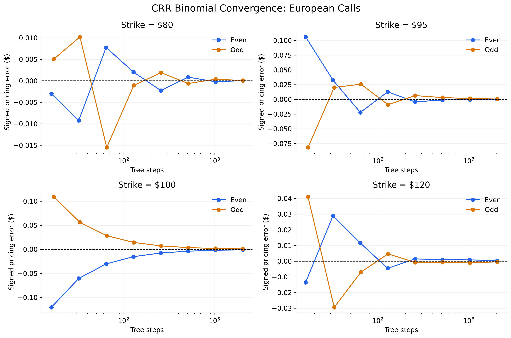

# Derivatives Pricing Laboratory

[](https://derivatives-research-lab.streamlit.app)

[](https://docs.python.org/3.14/)
[](https://github.com/LakshSuri/derivatives-pricing-lab/actions/workflows/tests.yml)
[](LICENSE)

A computational finance laboratory for European and American option valuation, numerical approximation, stochastic simulation, variance reduction, sensitivity analysis, and reproducible mathematical research.

The project investigates established derivatives pricing methods under controlled mathematical assumptions, emphasizing numerical accuracy, convergence, statistical uncertainty, and computational efficiency.

**[Technical Report](research/technical_report.md) · [Research Datasets](results/data/) · [Research Figures](results/figures/) · [Releases](https://github.com/LakshSuri/derivatives-pricing-lab/releases) · [Continuous Integration](https://github.com/LakshSuri/derivatives-pricing-lab/actions/workflows/tests.yml)**

## Overview

| Pricing Implementations | Computational Studies | Experimental Observations | Passing Local Tests |
|:---:|:---:|:---:|:---:|
| 6 | 5 | 2,958 | 309 |

The laboratory integrates one analytical pricing model, one lattice-based numerical model, and four Monte Carlo estimators within a modular Python framework.

Additional capabilities include analytical and numerical calculations of five option Greeks, implied volatility inversion, thirteen interactive application features, eight interactive visualization types, eight published CSV datasets, and six research figures.

## Contents

- [Interactive Research Laboratory](#interactive-research-laboratory)
- [Quick Start](#quick-start)
- [Mathematical Framework](#mathematical-framework)
- [Research Findings](#research-findings)
- [Python Examples](#python-examples)
- [Project Architecture](#project-architecture)
- [Reproducibility and Validation](#reproducibility-and-validation)
- [Technical Documentation](#technical-documentation)
- [Limitations](#limitations)
- [References](#references)
- [Future Development](#future-development)
- [Development Transparency](#development-transparency)
- [License](#license)

## Interactive Research Laboratory

**[Launch the live application](https://derivatives-research-lab.streamlit.app)**

The web application provides seven integrated research
workspaces powered by the underlying computational engines.

| Workspace | Capabilities |
|---|---|
| Overview | Research metrics and computational findings |
| Option Valuation | Analytical and lattice-based valuation |
| Sensitivity Analysis | Analytical and numerical Greeks |
| Monte Carlo Laboratory | Stochastic simulation and variance reduction |
| Implied Volatility | Numerical inversion and conditioning analysis |
| Pricing Surfaces | Interactive 3D surfaces and contour maps |
| Research Library | Datasets, figures and reproducibility resources |

The publicly hosted application requires no local installation.

To run the web application locally:

```bash
python -m streamlit run app.py
```

The application uses synthetic model parameters for educational
and computational research.

## Quick Start

### Installation

Python 3.14 is the primary development environment. The recorded computational experiments were conducted using CPython 3.14.6 on macOS with ARM64 architecture.

For macOS or Linux with Python 3.14 installed:

```bash
git clone https://github.com/LakshSuri/derivatives-pricing-lab.git
cd derivatives-pricing-lab

python3.14 -m venv .venv
source .venv/bin/activate

python -m pip install -r requirements.txt
python -m pip check
```

For Windows PowerShell, create and activate the virtual environment using:

```powershell
py -3.14 -m venv .venv
.venv\Scripts\Activate.ps1
```

Then install the dependencies using the same pip commands. Windows compatibility has not been independently validated.

### Running the Application

```bash
python main.py
```

The interactive command-line application provides the following capabilities:

| Analytical Pricing | Sensitivity Analysis | Computational Finance |
|---|---|---|
| European call pricing | Volatility sensitivity | Implied volatility solver |
| European put pricing | Expiration sensitivity | European and American binomial pricing |
| Call and put comparison | Interactive visualizations | Monte Carlo pricing |
| Analytical Greeks | Put-call parity verification | Pricing model comparison |
| | | Numerical Greeks validation |

The visualization menu supports option pricing curves, volatility sensitivity, expiration sensitivity, and all five option Greeks.

Rates, volatility, and dividend yields are entered as percentages in the interactive application and as decimals when using the Python functions.

## Mathematical Framework

### Core Computational Methods

| Method | Implementation | Capabilities |
|---|---|---|
| Black-Scholes-Merton | [pricing.py](pricing.py) | Analytical European call and put valuation with continuous dividend yields |
| Cox-Ross-Rubinstein | [lattice.py](lattice.py) | European and American option valuation through backward induction |
| Monte Carlo | [monte_carlo.py](monte_carlo.py) | Stochastic valuation, variance reduction, and statistical uncertainty |
| Implied Volatility | [implied_volatility.py](implied_volatility.py) | Price-bound validation and numerical inversion |
| Analytical Greeks | [analysis.py](analysis.py) | Closed-form option sensitivities |
| Numerical Greeks | [numerical_greeks.py](numerical_greeks.py) | Central finite-difference approximations |

### Black-Scholes-Merton Model

The dividend-adjusted European call price is:

```math
C = Se^{-qT}N(d_1)-Ke^{-rT}N(d_2)
```

where

```math
d_1=\frac{\ln(S/K)+(r-q+\sigma^2/2)T}{\sigma\sqrt{T}}
```

```math
d_2=d_1-\sigma\sqrt{T}
```

| Parameter | Definition |
|---|---|
| S | Underlying asset price |
| K | Strike price |
| T | Time to expiration in years |
| r | Continuously compounded risk-free interest rate |
| q | Continuous dividend yield |
| σ | Annualized volatility |
| N | Standard normal cumulative distribution function |

The analytical implementation also supports European put valuation and dividend-adjusted put-call parity.

### Binomial Pricing

The Cox-Ross-Rubinstein implementation uses a recombining binomial tree to approximate option values through risk-neutral probabilities and backward induction.

European options are valued using terminal payoffs. American options additionally compare continuation value against immediate exercise value at each applicable tree node.

The implementation supports adjustable tree resolution and early-exercise premium estimation.

### Monte Carlo Simulation

Four stochastic estimators are available:

| Estimator | Methodology |
|---|---|
| Standard | Independent random sampling |
| Antithetic | Paired positive and negative random shocks |
| Control Variate | Adjustment using a control with known expectation |
| Combined | Antithetic sampling with control variates |

The simulation engine provides standard deviations, standard errors, approximate 95% confidence intervals, and fixed-seed reproducibility.

Antithetic pair averages are treated as independent observations for uncertainty estimation. Control coefficients are estimated from separate pilot samples, which are included in the total simulation budget.

### Implied Volatility

The numerical solver recovers volatility from a European option price using an expanding search bracket followed by bisection.

The implementation validates strict theoretical pricing bounds before attempting inversion.

### Option Greeks

| Greek | Interpretation |
|---|---|
| Delta | Sensitivity to the underlying asset price |
| Gamma | Sensitivity of Delta to the underlying asset price |
| Theta | Sensitivity to the passage of calendar time |
| Vega | Sensitivity to model volatility |
| Rho | Sensitivity to the risk-free interest rate |

Both analytical and central finite-difference implementations are available.

Theta is reported per calendar day. Vega and Rho are reported per percentage-point change in volatility and interest rates, respectively.

Detailed mathematical derivations are available in the [technical research report](research/technical_report.md).

## Research Findings

Five computational studies investigate approximation accuracy, convergence, statistical efficiency, numerical conditioning, and execution time.

| Computational Study | Recorded Observations | Published Data |
|---|---:|---|
| Binomial convergence | 128 | [Dataset](results/data/tree_convergence.csv) |
| Monte Carlo convergence | 1,600 | [Summary](results/data/monte_carlo_summary.csv) · [Replications](results/data/monte_carlo_replications.csv) |
| Numerical Greek stability | 390 | [Dataset](results/data/greek_stability.csv) · [Optimal Steps](results/data/optimal_greek_steps.csv) |
| Implied volatility conditioning | 240 | [Dataset](results/data/volatility_conditioning.csv) |
| Computational benchmarking | 600 | [Summary](results/data/benchmark_summary.csv) · [Replications](results/data/benchmark_replications.csv) |
| **Total** | **2,958** | |

The observation count excludes summary rows and does not imply statistical independence across all observations.

### 1. Binomial Convergence

The convergence experiment evaluates four strike prices, two European option types, and sixteen tree resolutions ranging from 16 to 2,049 steps.

For a European call with a strike price of 80 USD, signed pricing error changes from approximately -0.002995 at 16 steps to -0.009224 at 32 steps.

This demonstrates that increasing tree resolution does not necessarily produce monotonic reductions in pricing error.

Consecutive even and odd resolutions are included to investigate oscillatory convergence behavior.



*Figure 1. Signed European call pricing error across even and odd binomial tree resolutions.*

### 2. Monte Carlo Convergence and Variance Reduction

Four estimators were evaluated across four simulation budgets, using 100 independent replications per configuration.

The reference European call configuration uses the following parameters:

| Parameter | Value |
|---|---:|
| Underlying asset price | 100 USD |
| Strike price | 105 USD |
| Expiration | 1 year |
| Risk-free rate | 5% |
| Annualized volatility | 25% |
| Continuous dividend yield | 2% |
| Analytical reference price | 8.941176 USD |

The experiment produced the following root mean squared errors:

| Simulation Budget | Standard | Antithetic | Control | Combined |
|---:|---:|---:|---:|---:|
| 1,024 | 0.516336 | 0.359410 | 0.239647 | 0.109060 |
| 4,096 | 0.223915 | 0.192989 | 0.115875 | 0.056191 |
| 16,384 | 0.121932 | 0.097804 | 0.060858 | 0.025163 |
| 65,536 | 0.068021 | 0.050569 | 0.028845 | 0.013657 |

The combined estimator achieved the lowest observed RMSE at every tested simulation budget.

At 65,536 evaluations, combining antithetic and control variates reduced RMSE by approximately **79.9%** relative to standard Monte Carlo.

The corresponding empirical mean squared error ratio was approximately **24.81**.

This ratio measures statistical efficiency at equal evaluation budgets rather than a direct runtime speedup.


*Figure 2. Observed root mean squared error across simulation budgets, including a reference convergence slope of -1/2.*

#### Confidence Interval Coverage

At the largest simulation budget, observed coverage of approximate 95% confidence intervals was:

| Estimator | Empirical Coverage | Relative MSE Efficiency |
|---|---:|---:|
| Standard | 94% | 1.00 |
| Antithetic | 98% | 1.81 |
| Control | 97% | 5.56 |
| Combined | 97% | 24.81 |

The measured coverage rates are broadly consistent with the nominal 95% confidence level, although 100 replications limit the precision of these estimates.


*Figure 3. Empirical confidence interval coverage relative to the nominal 95% level.*

### 3. Numerical Greek Stability

Thirteen relative finite-difference step sizes, ranging from 1e-1 to 1e-13, were evaluated across three market scenarios, two option types, and five Greeks.

| Greek | Best Observed Relative Step Sizes |
|---|---|
| Delta | 1e-7 to 1e-6 |
| Gamma | 1e-4 |
| Theta | 1e-5 |
| Vega | 1e-6 to 1e-5 |
| Rho | 1e-5 to 1e-3 |

Gamma achieved its minimum observed numerical error at a relative step size of 1e-4 in all six tested scenario and option-type combinations.

The results illustrate the interaction between finite-difference truncation error and floating-point cancellation.

These step sizes represent empirical minima within the tested grid rather than universally optimal numerical parameters.


*Figure 4. Finite-difference stability for Delta and Gamma under at-the-money option configurations.*

### 4. Implied Volatility Conditioning

The implied volatility study evaluates five strike prices, four expiration periods, two option types, and six option-price perturbations.

| Experimental Outcome | Observations |
|---|---:|
| Successful numerical recoveries | 208 |
| Outside strict pricing bounds | 32 |
| Solver failures | 0 |
| **Total** | **240** |

For a locally invertible European option pricing function, the sensitivity of implied volatility to option price is:

```math
\frac{\partial \sigma}{\partial V}
=
\frac{1}{\partial V/\partial \sigma}
```

Low Vega can amplify small option-price perturbations into substantial implied volatility errors.


*Figure 5. Theoretical local inverse sensitivity across strike prices and expiration periods.*

The heatmap represents local conditioning rather than realized recovery errors from individual price perturbations.

### 5. Computational Benchmarking

Twenty computational configurations were evaluated using thirty timed executions per configuration.

Selected results from the recorded development environment are presented below.

| Model | Resolution | Median Runtime (ms) | RMSE |
|---|---:|---:|---:|
| Black-Scholes-Merton | Analytical | 0.001167 | 0 |
| CRR Binomial | 1,024 steps | 2.086354 | 0.000449 |
| Standard Monte Carlo | 65,536 | 0.933958 | 0.056573 |
| Antithetic Monte Carlo | 65,536 | 0.755375 | 0.052959 |
| Control Variate | 65,536 | 0.920001 | 0.027772 |
| Combined Monte Carlo | 65,536 | 0.794209 | 0.013368 |

The analytical model serves as the reference and therefore has zero measured approximation error by construction.

Among the tested non-reference configurations, the 1,024-step binomial tree achieved the lowest pricing error. The combined Monte Carlo estimator achieved the lowest stochastic RMSE.

Tree resolutions and simulation budgets represent different computational units. Execution times depend on hardware, software, and system load.


*Figure 6. Measured computational cost versus numerical pricing accuracy.*

The zero-error analytical reference is excluded from the logarithmic performance plot.

## Python Examples

The mathematical engines can be imported directly from the repository root.

```python
from pricing import black_scholes_call
from lattice import crr_price
from monte_carlo import monte_carlo_price
from implied_volatility import implied_volatility
from analysis import calculate_greeks
from numerical_greeks import numerical_greeks

market = (100, 105, 1, 0.05, 0.25)
dividend_yield = 0.02

# Analytical European call valuation

reference = black_scholes_call(
    *market,
    dividend_yield=dividend_yield
)

print(f"European call: {reference:.6f}")

# American put valuation

american_put = crr_price(
    *market,
    steps=1024,
    option_type="put",
    exercise_style="american",
    dividend_yield=dividend_yield
)

print(f"American put: {american_put:.6f}")

# Monte Carlo valuation with variance reduction

estimate = monte_carlo_price(
    *market,
    simulations=65536,
    option_type="call",
    dividend_yield=dividend_yield,
    seed=42,
    method="combined"
)

print("Monte Carlo estimate:", estimate["price"])
print("Standard error:", estimate["standard_error"])
print("Approximate 95% CI:", estimate["confidence_interval"])

# Implied volatility recovery

recovered = implied_volatility(
    reference,
    *market[:4],
    option_type="call",
    dividend_yield=dividend_yield
)

print(f"Implied volatility: {recovered:.2%}")

# Analytical and numerical Greek comparison

analytical = calculate_greeks(
    *market,
    option_type="call",
    dividend_yield=dividend_yield
)

numerical = numerical_greeks(
    *market,
    option_type="call",
    dividend_yield=dividend_yield
)

for greek in analytical:
    print(greek, analytical[greek], numerical[greek])
```

The analytical European call price should be approximately 8.941176 USD. Recovered implied volatility should be approximately 25%.

The Monte Carlo estimate uses a fixed random seed for reproducibility.

## Project Architecture

```text
derivatives-pricing-lab/
├── main.py
├── pricing.py
├── analysis.py
├── lattice.py
├── monte_carlo.py
├── implied_volatility.py
├── numerical_greeks.py
├── visualization.py
├── experiments.py
│
├── research/
│   ├── __init__.py
│   ├── numerical_stability.py
│   ├── volatility_conditioning.py
│   ├── benchmarks.py
│   ├── figures.py
│   ├── environment.py
│   ├── reproduce.py
│   └── technical_report.md
│
├── results/
│   ├── data/
│   ├── figures/
│   └── environment.json
│
├── tests/
│   ├── test_analysis.py
│   ├── test_dividends.py
│   ├── test_implied_volatility.py
│   ├── test_interface.py
│   ├── test_lattice.py
│   ├── test_monte_carlo.py
│   ├── test_numerical_greeks.py
│   ├── test_pricing.py
│   └── test_research_pipeline.py
│
├── .github/
│   └── workflows/
│       └── tests.yml
│
├── .gitignore
├── requirements.txt
├── LICENSE
└── README.md
```

| Component | Responsibility |
|---|---|
| Core mathematical modules | Analytical, numerical, and stochastic calculations |
| [main.py](main.py) | Interactive application and input handling |
| [visualization.py](visualization.py) | Interactive pricing and sensitivity visualizations |
| [experiments.py](experiments.py) | Binomial and Monte Carlo convergence studies |
| [research/](research/) | Computational experiments, reproducibility, and technical documentation |
| [results/](results/) | Published datasets, research figures, and environment metadata |
| [tests/](tests/) | Mathematical, statistical, and software validation |
| [GitHub Actions](https://github.com/LakshSuri/derivatives-pricing-lab/actions) | Automated continuous integration |

## Reproducibility and Validation

### Research Reproduction

Regenerate all five computational studies, eight CSV datasets, six research figures, and environment metadata using:

```bash
python -m research.reproduce
```

Generated outputs are stored separately:

```text
reproduced-results/
├── data/
├── figures/
└── environment.json
```

The unified reproduction command preserves the original published experimental results by default.

Individual research modules can also be executed separately, but their default output directories may overwrite previously generated results.

### Computational Environment

The recorded development environment uses the following software:

| Technology | Recorded Version |
|---|---|
| [CPython](https://docs.python.org/3.14/) | 3.14.6 |
| [NumPy](https://numpy.org/doc/) | 2.5.5 |
| [Matplotlib](https://matplotlib.org/stable/) | 3.11.2 |
| [pytest](https://docs.pytest.org/) | 9.2.0 |

Direct Python dependencies are pinned in [requirements.txt](requirements.txt).

Additional operating system, architecture, dependency, and experimental configuration information is available in [environment.json](results/environment.json).

The Monte Carlo and benchmark experiments use seed 42.

Fixed seeds and pinned direct dependencies support reproducibility, although runtime measurements and floating-point results may vary across computing environments.

### Automated Testing

Execute the complete test suite:

```bash
python -m pytest -q
```

Recorded local validation:

```text
309 passed
```

The automated test suite covers:

- Analytical option valuation.
- Dividend-adjusted pricing.
- Put-call parity.
- Mathematical input validation.
- Analytical and numerical Greeks.
- Implied volatility recovery.
- European and American binomial valuation.
- Monte Carlo reproducibility.
- Variance reduction and statistical uncertainty.
- Research dataset integrity.
- Research figure generation.
- Interactive application behavior.
- Visualization data accuracy.
- Invalid input and calculation error recovery.

### Continuous Integration

GitHub Actions automatically validates the project using Python 3.14 on Ubuntu.

The workflow installs dependencies, checks dependency compatibility, and executes the automated test suite.

[View Continuous Integration](https://github.com/LakshSuri/derivatives-pricing-lab/actions/workflows/tests.yml)

The status badge at the top of this README reflects the reported workflow status for the main branch.

### Version History

Versioned releases provide identifiable snapshots of the software, documentation, and computational research materials.

[View Releases and Release Notes](https://github.com/LakshSuri/derivatives-pricing-lab/releases)

## Technical Documentation

The complete research methodology, mathematical derivations, experimental designs, results, and academic references are documented in:

**[Computational Analysis of Derivatives Pricing Models](research/technical_report.md)**

Supporting materials:

- [Computational Research Datasets](results/data/)
- [Published Research Figures](results/figures/)
- [Experimental Environment](results/environment.json)
- [Automated Test Suite](tests/)
- [Repository Commit History](https://github.com/LakshSuri/derivatives-pricing-lab/commits/main/)

## Limitations

The current laboratory operates under simplified financial market assumptions.

- Constant volatility, interest rates, and continuous dividend yields.
- Synthetic market configurations rather than observed historical option prices.
- No transaction costs, liquidity modeling, or market microstructure.
- Limited experimental parameter grids.
- Approximate Monte Carlo confidence intervals.
- Finite-sample statistical uncertainty.
- Restricted implied volatility search domain.
- Discrete approximation of American early exercise.
- European terminal-payoff Monte Carlo valuation.
- Floating-point sensitivity in numerical differentiation.
- Hardware-dependent runtime measurements.

Passing automated tests provides evidence of correctness within tested configurations rather than guaranteeing correctness for every possible input.

The project evaluates established mathematical models under controlled conditions. It does not establish real-world predictive accuracy or trading profitability.

## References

1. Black, F., & Scholes, M. (1973). [The Pricing of Options and Corporate Liabilities](https://doi.org/10.1086/260062). *Journal of Political Economy, 81*(3), 637–654.

2. Merton, R. C. (1973). [Theory of Rational Option Pricing](https://doi.org/10.2307/3003143). *Bell Journal of Economics and Management Science, 4*(1), 141–183.

3. Cox, J. C., Ross, S. A., & Rubinstein, M. (1979). [Option Pricing: A Simplified Approach](https://doi.org/10.1016/0304-405X(79)90015-1). *Journal of Financial Economics, 7*(3), 229–263.

4. Glasserman, P. (2004). [Monte Carlo Methods in Financial Engineering](https://doi.org/10.1007/978-0-387-21617-1). Springer.

## Future Development

Potential extensions include:

- Stochastic volatility modeling.
- Heston model calibration.
- Implied volatility surface construction.
- Quasi-Monte Carlo simulation.
- Jump-diffusion processes.
- Longstaff-Schwartz American option valuation.
- Adaptive numerical differentiation.
- Historical option-chain validation.
- Broader cross-platform benchmarking.
- Continued expansion of interactive research workspaces.
- Integration with a comprehensive quantitative research platform.

## Development Transparency

The repository owner executed the computational experiments and automated tests locally and managed the development repository.

The project investigates established mathematical methods through reproducible computational experiments rather than claiming original discovery of the underlying models or peer-reviewed publication.

**Repository Owner:** [Laksh Suri](https://github.com/LakshSuri)

Research interests include quantitative finance, computational mathematics, probability, statistics, and software development.

## License

This project's software is distributed under the [MIT License](LICENSE), subject to applicable third-party rights and licensing requirements.

Copyright © 2026 Laksh Suri.

See the [LICENSE](LICENSE) file for the complete license terms.

---

Developed for educational and computational research purposes. Not intended for investment or trading decisions.