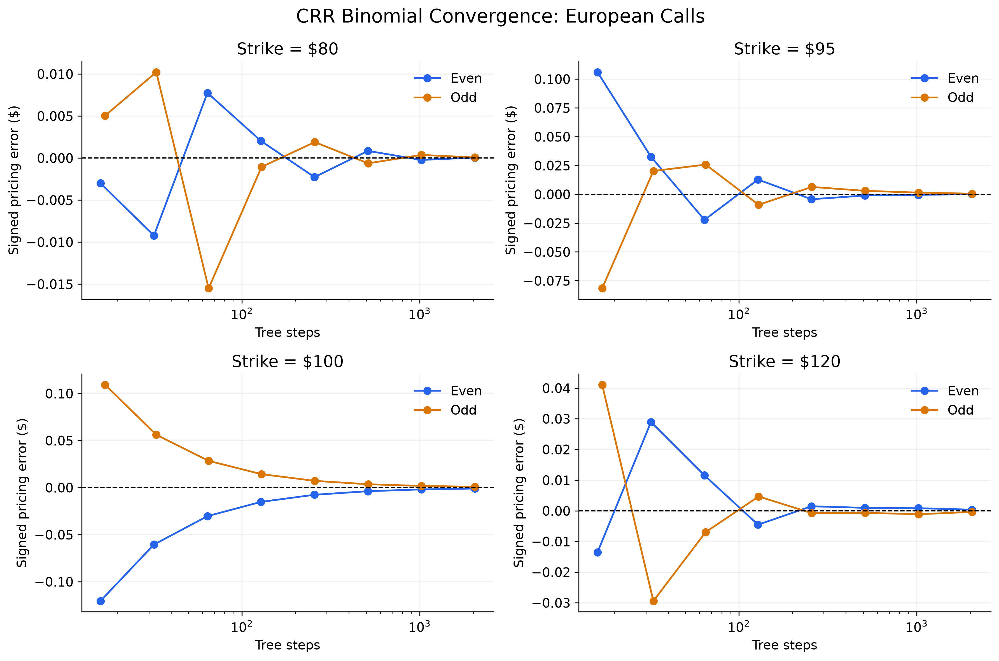
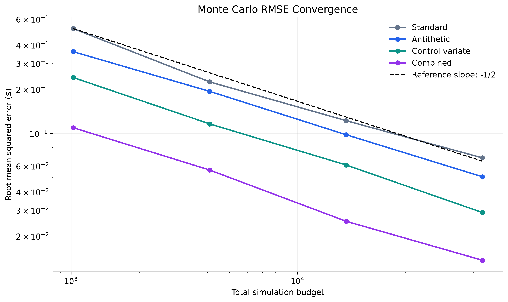
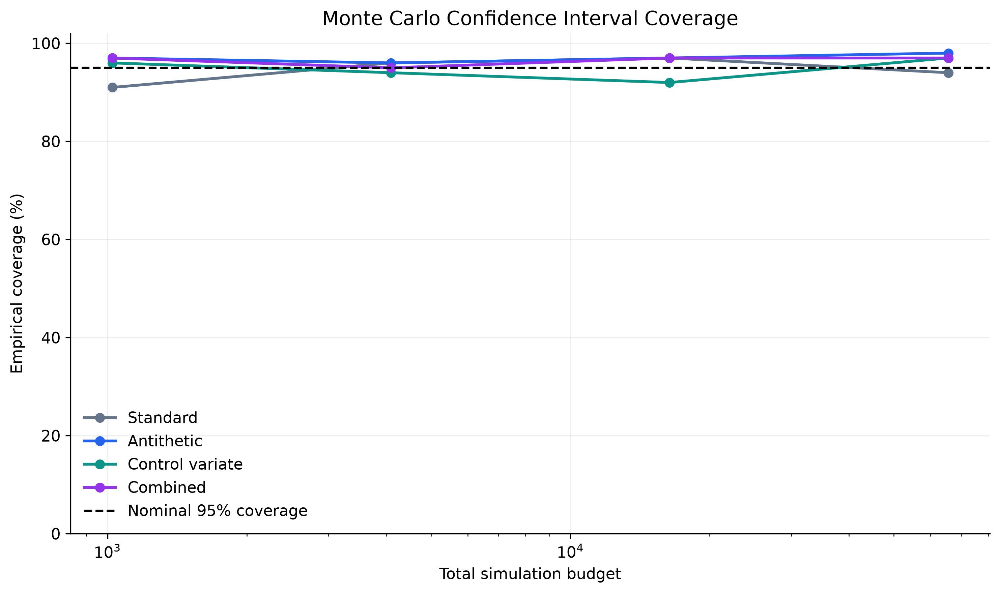
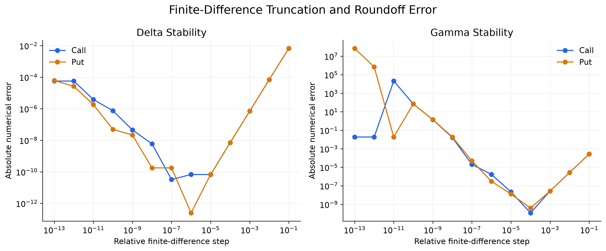
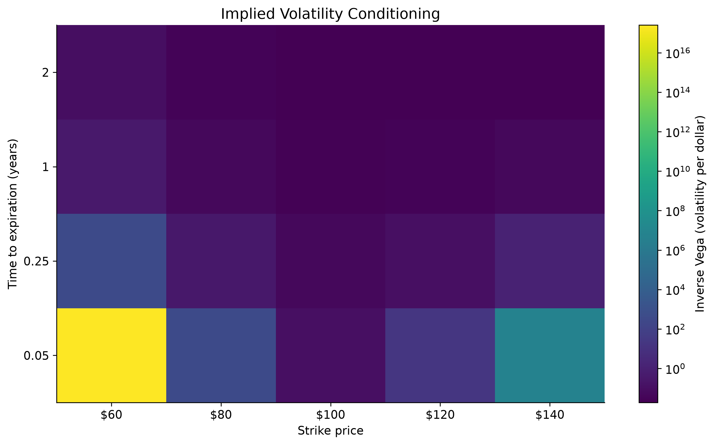
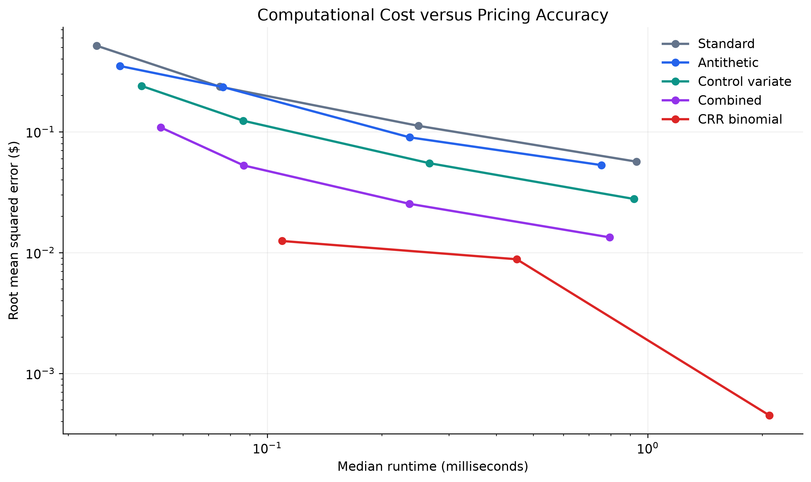

# Computational Analysis of Derivatives Pricing Models

## Abstract

This project investigates the numerical accuracy, convergence behavior, statistical efficiency, and computational performance of several derivatives pricing methods. The implemented framework includes the Black-Scholes-Merton analytical model, Cox-Ross-Rubinstein binomial trees, Monte Carlo simulation with variance reduction, implied volatility estimation, and finite-difference sensitivity analysis.

Five computational studies produced 2,958 experimental observations and six research figures. Under the selected market conditions, combining antithetic and control variates reduced Monte Carlo root mean squared error by approximately 79.9% at a budget of 65,536 simulations relative to the standard estimator.

The numerical stability experiments also demonstrate the importance of selecting appropriate finite-difference step sizes. These results illustrate the relationship between numerical accuracy, statistical uncertainty, computational cost, and model assumptions.

## 1. Research Objectives

The project investigates five primary questions:

1. How does binomial tree resolution affect pricing accuracy?
2. How effectively do variance reduction methods improve Monte Carlo estimates?
3. How does finite-difference step size influence numerical Greek accuracy?
4. How sensitive is implied volatility to perturbations in option prices?
5. What trade-offs exist between computational runtime and pricing accuracy?

## 2. Mathematical Framework

### 2.1 Black-Scholes-Merton Model

Let:

- S represent the underlying asset price.
- K represent the strike price.
- T represent time to expiration in years.
- r represent the continuously compounded risk-free rate.
- q represent the continuous dividend yield.
- sigma represent annualized volatility.
- N represent the standard normal cumulative distribution function.

Under the assumptions of the model, the European call price is

$$
C=Se^{-qT}N(d_1)-Ke^{-rT}N(d_2)
$$

The European put price is

$$
P=Ke^{-rT}N(-d_2)-Se^{-qT}N(-d_1)
$$

where

$$
d_1=\frac{\ln(S/K)+(r-q+\sigma^2/2)T}{\sigma\sqrt{T}}
$$

and

$$
d_2=d_1-\sigma\sqrt{T}.
$$

The implementation supports continuous dividends and validates the mathematical input domain.

Put-call parity provides an additional consistency condition:

$$
C-P=Se^{-qT}-Ke^{-rT}.
$$

The analytical model serves as the reference for European option pricing experiments.

### 2.2 Cox-Ross-Rubinstein Binomial Model

The binomial model approximates asset price movements through a discrete recombining tree.

For n time steps,

$$
\Delta t=\frac{T}{n}.
$$

The upward and downward movement factors are

$$
u=e^{\sigma\sqrt{\Delta t}},
\qquad d=\frac{1}{u}.
$$

The risk-neutral probability is

$$
p=\frac{e^{(r-q)\Delta t}-d}{u-d}.
$$

The continuation value at each node is

$$
V=e^{-r\Delta t}[pV_u+(1-p)V_d].
$$

For American options, the continuation value is compared against the immediate exercise value:

$$
V=\max(V_{\text{exercise}},V_{\text{continuation}}).
$$

The implementation uses backward induction and supports both European and American exercise styles.

### 2.3 Monte Carlo Simulation

Under the risk-neutral geometric Brownian motion model, the terminal asset price is

$$
S_T=S_0\exp\left[
(r-q-\sigma^2/2)T+\sigma\sqrt{T}Z
\right]
$$

where Z follows a standard normal distribution.

The standard European call estimator is

$$
\hat C=\frac{e^{-rT}}{n}
\sum_{i=1}^{n}\max(S_T^{(i)}-K,0).
$$

The corresponding put estimator replaces the call payoff with

$$
\max(K-S_T^{(i)},0).
$$

The project implements four Monte Carlo estimators:

- Standard independent simulation.
- Antithetic variates.
- Control variates.
- Combined antithetic and control variates.

#### Antithetic Variates

Antithetic sampling pairs a random normal observation Z with its negative, -Z.

The average of paired payoffs is treated as one independent statistical observation. Negative covariance between paired payoffs can reduce estimator variance.

#### Control Variates

Let X represent the discounted option payoff and Y represent the discounted terminal asset price.

The expected control value is known analytically:

$$
E[Y]=S_0e^{-qT}.
$$

The adjusted estimator is

$$
\hat V=\bar X-\beta(\bar Y-E[Y]).
$$

The optimal population coefficient is

$$
\beta^*=\frac{\operatorname{Cov}(X,Y)}
{\operatorname{Var}(Y)}.
$$

The coefficient is estimated using an independent pilot sample. Pilot evaluations are included in the total computational budget to maintain fair comparisons.

#### Statistical Uncertainty

For m independent observations with sample standard deviation s,

$$
SE=\frac{s}{\sqrt{m}}.
$$

An approximate 95% confidence interval is

$$
\hat V\pm1.96SE.
$$

For antithetic estimators, the independent observations are pair averages rather than individual payoffs.

### 2.4 Implied Volatility

Implied volatility is the volatility parameter satisfying

$$
V_{\text{model}}(\sigma)=V_{\text{observed}}.
$$

The implementation uses an expanding search bracket followed by bisection.

Observed prices are checked against theoretical no-arbitrage bounds before numerical inversion.

For valid, nondegenerate European options, the Black-Scholes-Merton price increases with volatility. This monotonicity makes bisection a suitable root-finding method.

### 2.5 Analytical and Numerical Greeks

The project calculates five option sensitivities:

| Greek | Mathematical definition |
|---|---|
| Delta | First derivative with respect to asset price |
| Gamma | Second derivative with respect to asset price |
| Theta | Sensitivity to calendar time |
| Vega | Sensitivity to volatility |
| Rho | Sensitivity to the risk-free rate |

The numerical implementation approximates first derivatives using central finite differences:

$$
f'(x)\approx\frac{f(x+h)-f(x-h)}{2h}.
$$

Second derivatives are approximated using

$$
f''(x)\approx
\frac{f(x+h)-2f(x)+f(x-h)}{h^2}.
$$

Both approximations have second-order truncation error under suitable smoothness conditions.

Theta is reported per calendar day. Vega and Rho are reported per one percentage-point change in their respective inputs.

## 3. Experimental Methodology

The computational experiments use predetermined synthetic market configurations and fixed random seeds.

| Study | Observations |
|---|---:|
| Binomial convergence | 128 |
| Monte Carlo convergence | 1,600 |
| Numerical Greek stability | 390 |
| Implied volatility conditioning | 240 |
| Computational benchmarking | 600 |
| Total | 2,958 |

Summary datasets are not counted as additional independent observations.

The Black-Scholes-Merton solution serves as the reference price. The experiments evaluate numerical approximation error under common modeling assumptions rather than predictive accuracy against real market prices.

The primary accuracy metric is root mean squared error:

$$
RMSE=\sqrt{\frac{1}{m}
\sum_{i=1}^{m}(\hat V_i-V_{\text{reference}})^2}.
$$

Mean signed error is used to estimate bias:

$$
\text{Bias}=\frac{1}{m}
\sum_{i=1}^{m}(\hat V_i-V_{\text{reference}}).
$$

Relative statistical efficiency is defined as

$$
RE=\frac{MSE_{\text{standard}}}{MSE_{\text{method}}}.
$$

A value greater than one indicates improved measured statistical accuracy at the same simulation budget.

## 4. Experimental Results

### 4.1 Binomial Convergence

The binomial convergence experiment evaluates four strike prices, two option types, and sixteen tree resolutions ranging from 16 to 2,049 steps.

Consecutive even and odd resolutions are included to examine oscillatory convergence.

For example, the European call with a strike of 80 produced the following results:

| Steps | Estimated price | Signed error |
|---:|---:|---:|
| 16 | 22.761130 | -0.002995 |
| 17 | 22.769173 | 0.005047 |
| 32 | 22.754901 | -0.009224 |
| 33 | 22.774347 | 0.010221 |
| 64 | 22.771883 | 0.007758 |

The results demonstrate that increasing tree resolution does not necessarily reduce absolute pricing error monotonically.

### 4.2 Monte Carlo Convergence

Four Monte Carlo methods were evaluated at four simulation budgets with 100 replications per configuration.

The analytical reference price was approximately 8.941176.

| Simulations | Standard | Antithetic | Control | Combined |
|---:|---:|---:|---:|---:|
| 1,024 | 0.516336 | 0.359410 | 0.239647 | 0.109060 |
| 4,096 | 0.223915 | 0.192989 | 0.115875 | 0.056191 |
| 16,384 | 0.121932 | 0.097804 | 0.060858 | 0.025163 |
| 65,536 | 0.068021 | 0.050569 | 0.028845 | 0.013657 |

All values represent measured RMSE.

The combined estimator achieved the lowest RMSE at every tested simulation budget.

At the largest budget, the measured reduction in RMSE was approximately 79.9%, corresponding to a relative statistical efficiency of 24.81.

The results support the expected approximate convergence relationship

$$
RMSE=O(n^{-1/2}).
$$

However, finite-sample variation prevents the measured convergence rate from matching the theoretical relationship exactly.

### 4.3 Confidence Interval Coverage

At a simulation budget of 65,536, the measured empirical confidence interval coverage was:

| Method | Coverage |
|---|---:|
| Standard | 94% |
| Antithetic | 98% |
| Control | 97% |
| Combined | 97% |

These percentages are broadly consistent with the nominal 95% confidence level, although 100 replications provide limited precision for estimating coverage probabilities.

### 4.4 Numerical Greek Stability

The numerical differentiation experiment compares relative step sizes from 0.1 to 0.0000000000001.

The best observed relative step sizes were:

| Greek | Best observed relative step sizes |
|---|---|
| Delta | 1e-7 to 1e-6 |
| Gamma | 1e-4 |
| Theta | 1e-5 |
| Vega | 1e-6 to 1e-5 |
| Rho | 1e-5 to 1e-3 |

Gamma achieved its minimum observed error at a relative step size of 1e-4 in all six tested scenario and option-type combinations.

For central first derivatives, an approximate error model is

$$
E(h)\approx C_1h^2+C_2\frac{\epsilon}{h}.
$$

For central second derivatives,

$$
E(h)\approx C_1h^2+C_2\frac{\epsilon}{h^2}.
$$

The results are consistent with second derivatives being particularly sensitive to floating-point cancellation.

The reported optimal step sizes are empirical minima within the tested grid, not universal numerical constants.

### 4.5 Implied Volatility Conditioning

Small perturbations in synthetic option prices were used to investigate the stability of implied volatility recovery.

| Outcome | Observations |
|---|---:|
| Successful recoveries | 208 |
| Outside theoretical pricing bounds | 32 |
| Solver failures | 0 |
| Total | 240 |

Every valid observed price in this experimental configuration was successfully processed by the solver.

The local inverse sensitivity is

$$
\frac{\partial\sigma}{\partial V}
=\frac{1}{\partial V/\partial\sigma}.
$$

Therefore, low Vega can amplify small pricing perturbations into substantial implied volatility errors.

The conditioning heatmap displays inverse Vega across strike prices and expiration periods. It represents theoretical local sensitivity rather than the measured error from a particular perturbation.

### 4.6 Computational Performance

The benchmarking experiment evaluates twenty configurations with thirty executions per configuration.

| Model | Resolution | Median runtime (ms) | RMSE |
|---|---:|---:|---:|
| Black-Scholes | Analytical | 0.001167 | 0 |
| Binomial | 1,024 | 2.086354 | 0.000449 |
| Standard Monte Carlo | 65,536 | 0.933958 | 0.056573 |
| Antithetic | 65,536 | 0.755375 | 0.052959 |
| Control | 65,536 | 0.920001 | 0.027772 |
| Combined | 65,536 | 0.794209 | 0.013368 |

The analytical solution is the reference and therefore has zero measured approximation error by construction.

Among the tested numerical configurations, the 1,024-step binomial tree achieved the lowest pricing error.

The combined Monte Carlo estimator achieved the lowest RMSE among the stochastic methods while retaining comparable measured execution time.

The theoretical computational complexities of the implemented methods are:

| Method | Time complexity | Space complexity |
|---|---|---|
| Black-Scholes | O(1) | O(1) |
| Binomial tree | O(n²) | O(n) |
| Monte Carlo | O(n) | O(n) |

Runtime results depend on the execution environment and should not be interpreted as hardware-independent performance guarantees.

## 5. Software Validation

The project contains 186 locally passing automated tests covering:

- Analytical option pricing.
- Put-call parity and mathematical consistency.
- Analytical Greek calculations.
- Input validation.
- Implied volatility recovery.
- European and American binomial pricing.
- Monte Carlo reproducibility.
- Variance reduction estimators.
- Statistical uncertainty calculations.
- Numerical differentiation and convergence.
- Research dataset integrity.
- Environment metadata generation.
- Research figure generation.

Automated tests provide evidence of implementation correctness within their tested domains. They do not constitute a formal proof of correctness for every possible input.

## 6. Reproducibility

The original experimental datasets and figures are retained in the results directory.

Dependency versions are recorded in requirements.txt.

The entire research pipeline can be reproduced from the repository root using:

    python -m pip install -r requirements.txt
    python -m pytest -q
    python -m research.reproduce

Regenerated results are saved separately to prevent accidental modification of the original experimental data.

Additional environment information is recorded in:

- results/environment.json

Random seeds are fixed. Runtime measurements and some floating-point results may vary across machines and software environments.

## 7. Limitations

The project has several important limitations:

- The asset price dynamics assume geometric Brownian motion with constant volatility.
- Interest rates and dividend yields are assumed constant.
- Transaction costs, liquidity constraints, and market microstructure are excluded.
- The experiments use synthetic market configurations rather than historical option chain data.
- Monte Carlo experiments examine a limited set of market conditions.
- Confidence interval coverage estimates are based on finite replication counts.
- Numerical stability depends on parameter values and floating-point precision.
- The implied volatility solver has a restricted numerical search domain.
- The benchmarking study measures one local computing environment.
- American exercise is approximated through discrete tree nodes.
- The current Monte Carlo implementation addresses European terminal payoffs rather than general early-exercise or path-dependent contracts.

Consequently, these experiments evaluate numerical methods within a controlled mathematical framework, not the profitability of trading strategies.

## 8. Future Research

Potential extensions include:

- Stochastic volatility models.
- Heston model calibration.
- Implied volatility surface construction.
- Quasi-Monte Carlo simulation.
- Longstaff-Schwartz American option pricing.
- Adaptive numerical differentiation.
- Historical option chain validation.
- Jump-diffusion models.
- Model calibration and parameter uncertainty.
- Broader computational benchmarking across hardware platforms.

## 9. Conclusion

The results demonstrate how analytical solutions, lattice approximations, stochastic simulation, and numerical differentiation can be combined within a reproducible derivatives pricing framework.

The binomial experiments illustrate nonmonotonic numerical convergence. Monte Carlo experiments demonstrate the benefits of variance reduction under the selected conditions. The Greek stability study highlights the interaction between truncation and floating-point error, while the implied volatility experiments examine the sensitivity of an inverse pricing problem.

This project provides an educational computational foundation for further exploration of quantitative finance and numerical methods.

## 10. Development Transparency

This educational project was developed with substantial AI-assisted coding and technical guidance using ChatGPT. The repository owner executed the experiments and automated tests locally and managed the repository.

The experimental results reported here originate from the generated computational datasets. The project reproduces and investigates established mathematical methods rather than claiming original discoveries of those methods.

## 11. References and Further Reading

1. Black, F., and Scholes, M. (1973). The Pricing of Options and Corporate Liabilities. Journal of Political Economy, 81(3), 637-654.
   https://doi.org/10.1086/260062

2. Merton, R. C. (1973). Theory of Rational Option Pricing. Bell Journal of Economics and Management Science, 4(1), 141-183.
   https://doi.org/10.2307/3003143

3. Cox, J. C., Ross, S. A., and Rubinstein, M. (1979). Option Pricing: A Simplified Approach. Journal of Financial Economics, 7(3), 229-263.
   https://doi.org/10.1016/0304-405X(79)90015-1

4. Glasserman, P. (2004). Monte Carlo Methods in Financial Engineering. Springer.
   https://doi.org/10.1007/978-0-387-21617-1
